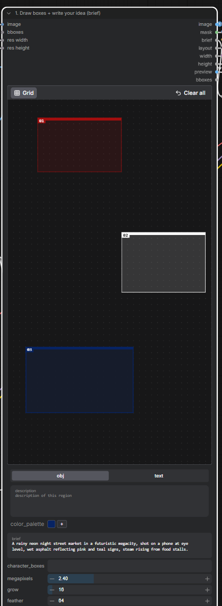
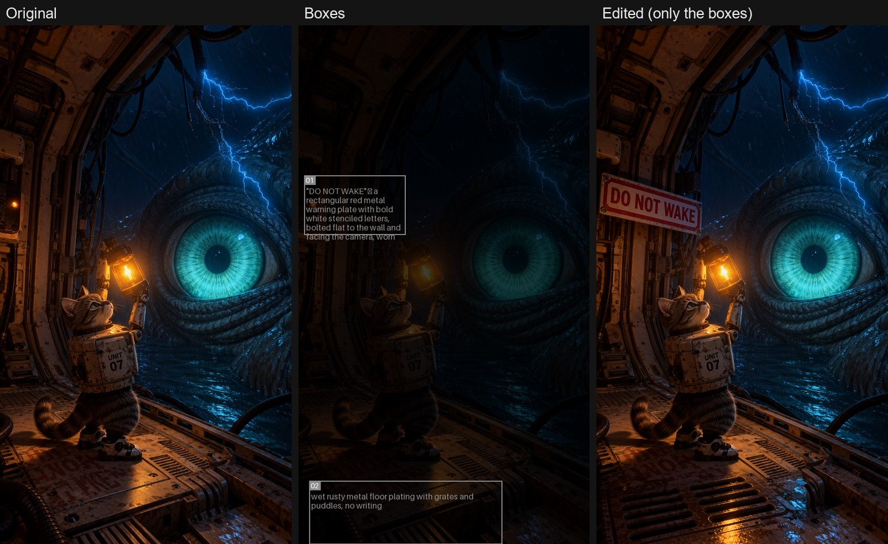
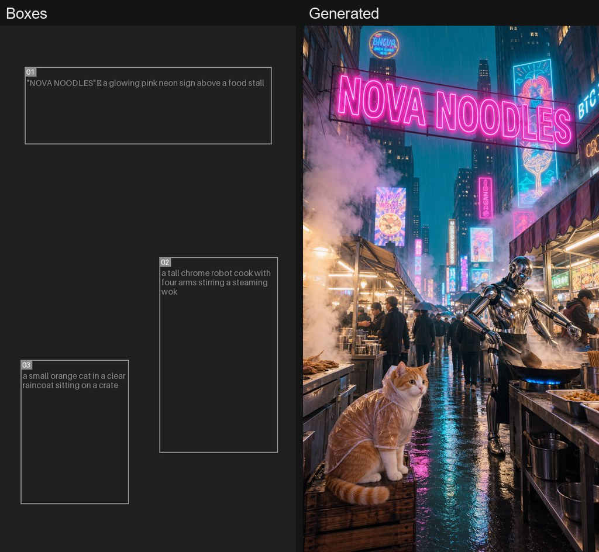
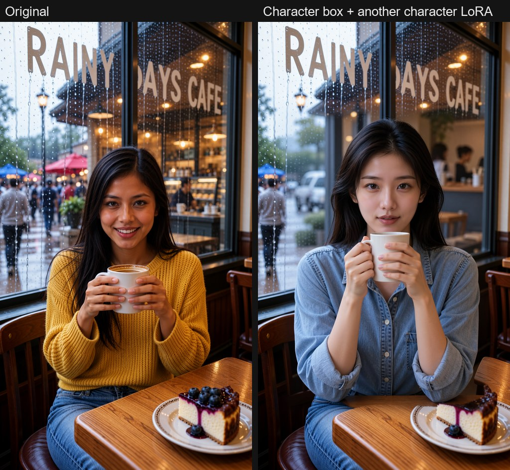
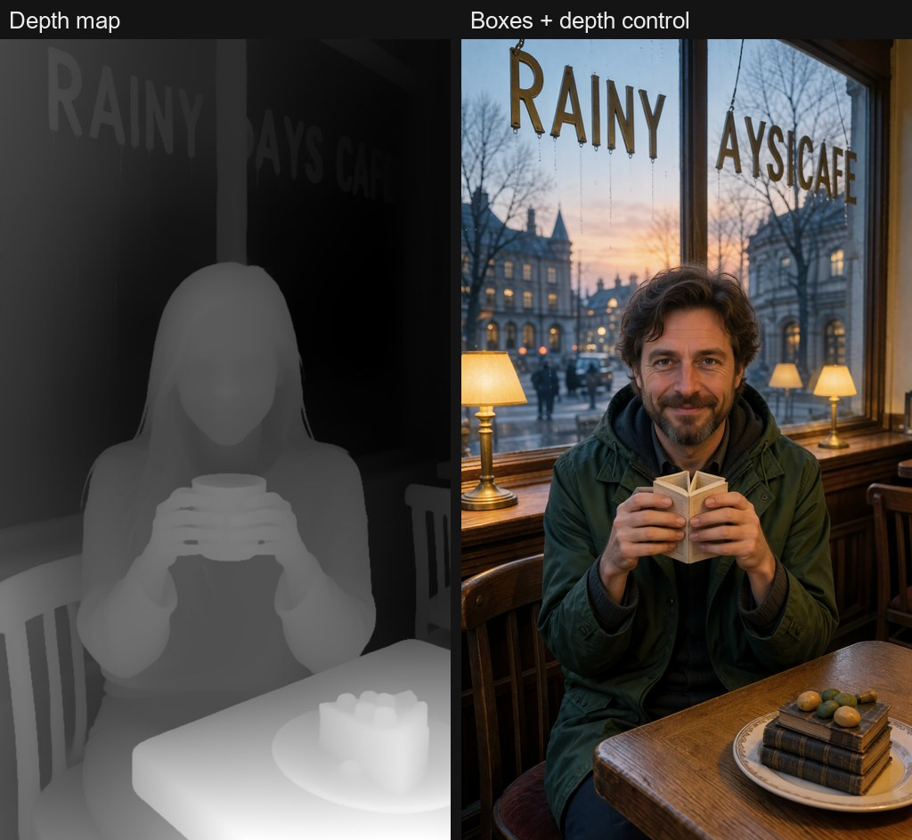

# ComfyUI-Artfat-MOSS-BBox

Box layouts for **MOSS-Image** in ComfyUI. Draw boxes on a canvas and write in each box what must be there.



- **Generate**: a new frame where every box holds what you wrote — a sign with exact words, an object, a character.
- **Edit**: redraw only the boxes of an existing picture. Everything outside the boxes stays pixel-identical, and the soft edge leaves no seam.

Two nodes do the work, so an LLM prompter can sit between them (plus **Frame Hold** to edit a frame you have just generated):

```
Artfat BBox Canvas ──brief──► LLM prompter ──prompt──► Artfat BBox Sampler ──► image
        │  └─ image ─────────► (sees the picture)          ▲
        └──── layout + mask + size ───────────────────────┘
```

The canvas tells the prompter what the boxes must hold, the prompter writes the prompt for the whole frame, the sampler draws it. It works just as well without an LLM: type the prompt yourself.

## Examples

**Edit: a sign and a floor redrawn, the rest untouched**



**Generate: every box holds what was written in it**



**Edit with a character box: another character LoRA in the same scene**



**Boxes together with depth control**



## Requirements

- **ComfyUI v0.42.0 or newer** (MOSS-Image support; the box canvas itself is in ComfyUI since v0.27.0). On an older ComfyUI the pack loads empty and prints one line asking you to update.
- **Nodes 2.0 turned on**: Settings → **Modern Node Design (Nodes 2.0)**. The box canvas is a Nodes 2.0 widget; with the classic node design it shows only "Bounding Boxes: Node 2.0 only".
- A MOSS-Image model (SFT or Base), the `moss_image` text encoder and the Flux 2 VAE, loaded with the standard ComfyUI loaders.
- **[RES4LYF](https://github.com/ClownsharkBatwing/RES4LYF)** for the sampler `res_6s` and scheduler `bong_tangent` the defaults are tuned for. Without it the sampler falls back to `euler` / `simple`, but the example workflow is saved with `res_6s` and stops with *"Value not in list"* until RES4LYF is installed (ComfyUI Manager → search **RES4LYF**). After a manual `git clone`, also run `pip install -r requirements.txt` in the RES4LYF folder with ComfyUI's Python (it needs PyWavelets).
- Optional: [Artfat LLM Prompter v2](https://github.com/artfat-creator/artfat-comfyui-llm-prompter-v2) for automatic prompts (task preset **BBox layout: whole frame with the [BOXES]**).
- Optional, for depth control: ComfyUI v0.42.2+ (`MOSS-Image Color/Depth Control`).

## Install

Not in the ComfyUI Manager list yet. ComfyUI Manager → **Install via Git URL** → paste `https://github.com/artfat-creator/ComfyUI-Artfat-MOSS-BBox`. Or:

```
cd ComfyUI/custom_nodes
git clone https://github.com/artfat-creator/ComfyUI-Artfat-MOSS-BBox
```

No extra Python packages. Restart ComfyUI, then open `example_workflows/MOSS_BBox_generate_and_edit.json`.

## Quick start

**Edit a picture**
1. Connect a **Load Image** to the canvas `image` input. The picture appears under the boxes.
2. Draw a box over each part to change. In the box editor pick *object* or *text*, write what must be there (for a text box: the exact words, plus what they are printed on).
3. Write the prompt for the whole frame **as it must look after the change**, or let the prompter do it.
4. Run. Only the boxes are redrawn and pasted back.

**Generate a new frame**
1. Bypass the Load Image (Ctrl+B) or leave the canvas `image` input empty.
2. Set `width` / `height` on the canvas and draw where each thing goes.
3. Write your idea in `brief` and run.

## Nodes

### Artfat BBox Canvas
The drawing canvas (ComfyUI's own bounding-box editor) plus everything the other nodes need.

| Input / widget | What it does |
|---|---|
| `image` (optional) | The picture to edit. Connected = edit mode, empty = generate mode. |
| `bboxes` (optional) | Boxes to start the canvas from. |
| `width`, `height` | Frame size in generate mode. In edit mode they follow the picture. |
| canvas | Draw the boxes; per box: object or text, the words, a description. |
| `brief` | Your idea for the whole frame. Sent on together with the box list. |
| `character_boxes` | Numbers of the boxes that hold your LoRA character, e.g. `1` or `1, 3`. |
| `megapixels` | Edit size: the picture is scaled to this many megapixels (multiple of 16). Default 2.0. |
| `grow` | Edit: how far past each box the redraw reaches, px. Default 16. |
| `feather` | Edit: soft edge past the grown box, px. Default 64. 0 = hard edge and a visible seam. |

| Output | What it carries |
|---|---|
| `image` | The scaled picture (edit) or nothing (generate). |
| `mask` | The redraw area with the soft edge. |
| `brief` | Your brief + a `[BOXES]` list: number, kind, place in the frame and size, content. Wire it into the prompter's brief. |
| `layout` | The boxes for the sampler. |
| `width`, `height` | The frame size the sampler must use. |
| `preview` | The boxes drawn over the frame. |
| `bboxes` | The boxes in pixels (for other box nodes). |

### Artfat BBox Sampler
Builds the MOSS layout prompt from your prompt + the boxes, samples and, in edit mode, pastes the result back through the mask (Differential Diffusion for the soft edge).

| Input / widget | What it does |
|---|---|
| `model`, `clip`, `vae` | The MOSS-Image model with your LoRAs already applied, its text encoder, the Flux 2 VAE. |
| `prompt` | The whole frame as it must look in the end. |
| `layout`, `image`, `mask`, `width`, `height` | From the canvas. |
| `seed`, `steps`, `cfg`, `sampler_name`, `scheduler` | Defaults: 8 steps, CFG 1, `res_6s` / `bong_tangent` when installed (RES4LYF), otherwise `euler` / `simple`. |
| `start_step` | Edit only. 0 = full redraw of the boxes. Higher keeps more of the old box content but weakens the change. |
| `positive`, `negative` (optional) | Your own conditioning, e.g. after depth control. Replaces the built-in encode. |

| Output | |
|---|---|
| `IMAGE` | The result. |
| `LATENT` | The sampled latent, for a second pass. |
| `layout_prompt` | The exact text the model received (layout JSON). |

### Artfat Edit Source
Put it in front of the canvas `image` input, with your Load Image wired into it. `edit last result` OFF: your photo goes to the canvas (Load Image bypassed = generate a new frame). ON: the frame the BBox Sampler drew last comes back into the canvas, so you can box and edit what you just generated. See *Edit what you just generated* below.

### Artfat Frame Hold
`hold` OFF: passes the generated frame through and remembers it. `hold` ON: returns the remembered frame and skips the generation. See *Generate, then edit the same frame* below.

### Artfat BBoxes to Mask
Pixel boxes (`bboxes`) → a mask with a soft edge (`feather`). For your own edit graphs built from core nodes.

## Tips

- **Describe the frame after the change.** In edit mode a prompt that still describes the old content (a description of the original picture) pulls the old thing back into the box.
- **Text boxes**: short words work best; give the box room. If the text comes out on the wrong surface, describe the surface in the box (`a red metal plate bolted to the wall`).
- **Moving text or an object**: box the new place with the new content and box the old place with what should be there instead (`plain wet floor, no writing`).
- **Hands and faces near a box edge** can glue together: cover them completely or keep the box off them.
- **Seam visible**: raise `feather`. **Change too weak**: keep `start_step` at 0.
- **Character boxes**: mark the box number in `character_boxes`; the prompter preset then leaves the look to your LoRA (no face or body description). In edit mode this puts a different character into the same scene: box the person, load the other character LoRA.
- **Box positions**: the sampler places boxes by fractions of the frame, so a canvas drawn at one size works at any other size of the same aspect.

## With depth control

Use the canvas `layout` with the core **MOSS-Image Layout Prompt** → **CLIP Text Encode** → **MOSS-Image Color/Depth Control**, and connect the result to the sampler's `positive`. The sampler then uses your conditioning as it is.

Depth wins over boxes where they disagree. Lettering in the depth source shows up in the depth map as relief, so a text box over that area renders the old letters, not yours. Keep text boxes where the depth source has no lettering, or lower the control `strength` / `end_percent`.

## Edit what you just generated (Artfat Edit Source)

A wire from the sampler back into the canvas would be a loop, so the BBox Sampler remembers every frame it draws and **Artfat Edit Source** hands it back to the canvas.

1. `edit last result` OFF, Load Image bypassed: generate as usual.
2. Switch `edit last result` ON and run once with no boxes - the picture goes through untouched (about a second) and shows under the canvas.
3. Draw boxes over what to change and run. Only the boxes are redrawn; every next run edits the newest result.

With the Artfat LLM Prompter use the task preset **User prompt -> edit**: it keeps your own prompt word for word and changes only what the boxes list (no boxes = the prompt is passed on and the LLM is not called). A prompt that still names the old object pulls it back into the box.

## Generate, then edit the same frame (Artfat Frame Hold)

To draw boxes on a frame you have just generated, put **Artfat Frame Hold** right after the VAE Decode of your generation and route every use of that frame through it (preview/save, the canvas `image`, the upscale).

1. `hold` OFF, run: the frame is generated and remembered.
2. Draw the boxes on it (it shows under the canvas), switch `hold` ON, run: the remembered frame is used and the generation is skipped, even with a random seed. Only the boxes are redrawn.
3. Switch `hold` OFF for a new frame.

The input is lazy: while `hold` is on, ComfyUI does not run the sampler behind it, unless another node in the graph still takes the generation directly. The remembered frame lives in memory until ComfyUI restarts.

## License

MIT
